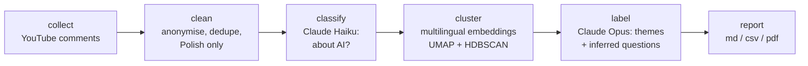

# ai-concerns-pl

*Co zwykli Polacy piszą i pytają o sztuczną inteligencję — z komentarzy do klastrów tematów i pytań do FAQ.*

A Python pipeline that mines what Polish lay internet users say and ask about AI. The goal is to understand their real concerns and questions so that answers and FAQs can be written for them. Current source: YouTube comments. More sources are planned (see Roadmap).

## Headline findings (current run)

60 YouTube videos → 12,290 comments → 10,468 kept after cleaning → 6,029 about AI → 30 themes covering 58% of those texts (the rest is clustering noise).

| Topic | Share |
|---|---|
| Jobs / economy | 29.9% |
| AI safety / x-risk | 29.6% |
| Capabilities / hype | 18.4% |
| Everyday use | 5.4% |
| Regulation / politics | 5.1% |
| Health | 3.4% |
| Privacy | 1.4% |

Top 5 themes by size:

1. AI job loss enriches corporations, impoverishes workers
2. Mass unemployment: who will buy anything?
3. Scattered sarcastic quips about AI (low coherence)
4. AI is just a tool that makes mistakes
5. Poland's place in the AI race

Full results: [out/report.pdf](out/report.pdf) · [out/report.md](out/report.md) · [out/clusters.csv](out/clusters.csv)

## Pipeline



## Setup

```bash
python3 -m venv .venv && . .venv/bin/activate
pip install torch --index-url https://download.pytorch.org/whl/cpu   # optional, CPU build
pip install -r requirements.txt
cp .env.example .env    # then fill in YOUTUBE_API_KEY and ANTHROPIC_API_KEY
```

The PDF stage needs headless Google Chrome (`google-chrome` on PATH).

## Usage

```bash
python run.py all                # everything
python run.py collect            # or one stage: collect | clean | classify | cluster | report | pdf
python run.py classify --yes     # approve a Claude stage whose estimate exceeds the budget
```

Any Claude stage whose estimated cost exceeds `llm.budget_usd` (default $5) aborts unless you pass `--yes`. Raw API responses are cached, so re-runs are cheap.

## Configuration (`config.yaml`)

| Key | Default | Meaning |
|---|---|---|
| `keywords` | 12 Polish queries | YouTube search terms |
| `date_range` | 2024-01-01 → today | Comment date window |
| `sources.youtube.max_videos` | 60 | Videos per run |
| `sources.youtube.max_comment_threads_per_video` | 300 | Top-level threads per video |
| `sources.youtube.max_replies_per_thread` | 50 | Replies per thread |
| `sources.youtube.order` | relevance | `relevance` / `viewCount` / `date` |
| `cleaning.min_words` | 5 | Drop shorter texts |
| `cleaning.min_polish_confidence` | 0.5 | Language filter threshold |
| `cleaning.near_dup_threshold` | 0.85 | MinHash Jaccard on word 3-shingles |
| `llm.classifier_model` / `labeler_model` | claude-haiku-5-5 / claude-opus-5-5 | Relevance filter / labelling |
| `llm.budget_usd` | 5.0 | Per-stage cost guard |
| `embedding.model` | paraphrase-multilingual-mpnet-base-v2 | Sentence embeddings |
| `clustering.*` | 15–40 target clusters | UMAP / HDBSCAN settings |
| `report.*` | 15 questions, 4 quotes | Report size |

## Outputs

- `out/report.md`, `out/report.pdf`: ranked themes, inferred questions per theme, representative quotes with links, caveats
- `out/clusters.csv`: one row per theme
- `data/corpus.sqlite`: anonymised corpus (items, clusters, runs)
- `data/*.log`: per-stage logs

## Data and privacy

The texts are public YouTube comments. The repo contains the anonymised corpus (`data/corpus.sqlite`): no author names or channel IDs are stored, and the pipeline strips @handles and URLs from text. Stripping is heuristic; a small number of handle-like strings (roughly 0.2% of texts) may remain. The `parent_context` column holds the video title and channel name (public creators).

Deliberately **not** committed: `data/cache/` (raw YouTube API responses, which include commenter display names and channel IDs), `data/*.npz` (regenerable embeddings), and intermediate files.

Data derived from public comments is shared for research purposes. If you are quoted and want a comment removed, open an issue.

## Costs

About $1.40 of Claude usage and about 600 YouTube API quota units for a 60-video run (with the cache).

## Limitations

- **Sampling bias.** Videos come from YouTube search for our keywords; this over-represents popular, sensational content and its commenters. It is not representative of Poles.
- **Per-video concentration.** Check the "1 video" column in the report before treating a theme as a general concern.
- **Model judgments.** Relevance (Haiku), clustering (HDBSCAN) and labels (Opus) are model outputs; spot-check quotes against the links.
- **Inferred questions.** They are what the model thinks commenters need to hear, not quotes.

## Roadmap

Reddit, Wykop, X via xAI, Google Trends, news-site comments (where terms of service allow).

## License

Code: MIT, see [LICENSE](LICENSE).
